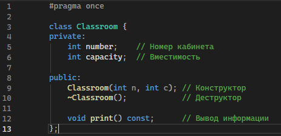
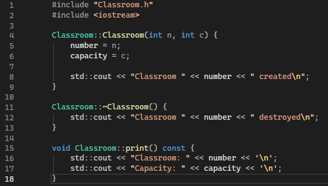
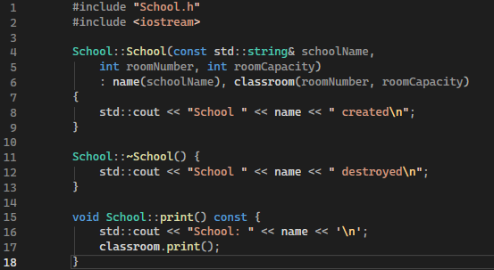
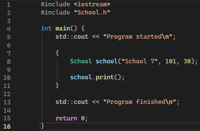
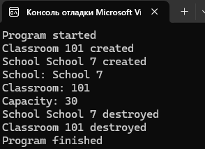

# Отчёт по лабораторной работе № 1: «Композиция и агрегация классов. Статические члены»

**Дисциплина:** «Алгоритмы и структуры данных»

**Студент:** Мовсесян Самвел

**Группа:** ПИЖ-б-о-25-2 (2)

**Вариант:** 7

**Ссылка на Git-репозиторий:** 

## 1. Тема и цель работы

**Тема работы:** «Композиция и агрегация классов. Статические члены».

**Цель работы:** изучить отношение композиции в объектно-ориентированном программировании на C++; научиться создавать классы, связанные отношением «часть–целое», и управлять временем жизни их объектов. Закрепить знания о конструкторах, деструкторах и полях-объектах на примере классов `School` и `Classroom`.

## 2. Краткое теоретическое обоснование

**Композиция** – отношение «часть–целое», при котором объект-целое владеет объектом-частью и управляет временем его жизни. В данной работе класс `School` содержит поле `Classroom classroom;`. Этот конкретный объект кабинета создаётся вместе с объектом школы и автоматически уничтожается при уничтожении школы.

**Конструктор** – специальная функция класса, вызываемая при создании объекта. Она предназначена для инициализации полей. В программе конструктор `Classroom` устанавливает номер и вместимость кабинета, а конструктор `School` задаёт название школы и создаёт принадлежащий ей кабинет.

**Деструктор** – специальная функция класса, автоматически вызываемая при уничтожении объекта. В программе деструкторы выводят сообщения, позволяющие проследить порядок уничтожения школы и кабинета. Поскольку кабинет хранится как обычное поле-объект, вручную удалять его через `delete` не требуется.

**Агрегация** – отношение, при котором объект использует другие объекты, но не владеет ими. В отличие от композиции, такие объекты могут продолжать существовать после уничтожения использующего их объекта. В данной работе реализована именно композиция, как требуется для базового уровня.

**Статические поля и методы** относятся к классу в целом, а не к отдельным объектам. Они рассматриваются в теоретической части лабораторной работы, но индивидуальное задание базового уровня не требует их реализации.

## 3. Методика выполнения лабораторной работы

### 3.1. Постановка индивидуального задания

**Вариант 7, базовый уровень:** реализовать два класса, связанных отношением композиции: `School` (целое) и `Classroom` (часть). Для класса `Classroom` предусмотреть поля «номер» и «вместимость». Продемонстрировать создание и уничтожение объектов.

В программе школа содержит один учебный кабинет как поле класса. Для наглядности предусмотрены сообщения конструкторов и деструкторов, а также вывод сведений о школе и кабинете.

### 3.2. Класс Classroom – учебный кабинет

Класс `Classroom` содержит два закрытых поля: `number` – номер кабинета и `capacity` – его вместимость. Конструктор получает эти значения и выводит сообщение о создании. Метод `print()` отображает информацию о кабинете. Деструктор сообщает об уничтожении объекта.

**Рисунок 1: Код файла Classroom.h**



**Рисунок 2: Код файла Classroom.cpp**



### 3.3. Класс School – школа и композиция

Класс `School` содержит название школы `name` и поле `Classroom classroom;`. Наличие объекта `Classroom` непосредственно в составе `School` обеспечивает композицию: кабинет создаётся при создании школы и уничтожается при уничтожении школы.

В конструкторе `School` используется список инициализации `: name(schoolName), classroom(roomNumber, roomCapacity)`. Он необходим для создания поля `classroom` с нужными параметрами. Метод `print()` отображает название школы и вызывает метод `print()` у кабинета.

Деструктор `School` выводит сообщение об уничтожении школы. После выполнения его тела автоматически вызывается деструктор поля `classroom`.

**Рисунок 3: Код файла School.h**

#pragma once

#include <string>
#include "Classroom.h"

class School {
private:
    std::string name;    
    Classroom classroom; 

public:
    School(const std::string& schoolName, int roomNumber, int roomCapacity);
    ~School();

    void print() const;
};

**Рисунок 4: Код файла School.cpp**



### 3.4. Демонстрационная программа main.cpp

В функции `main()` создаётся объект `School school("School 7", 101, 30);`. Он представляет школу «School 7», содержащую кабинет № 101 на 30 мест. Далее методом `school.print()` выводится информация об обоих объектах.

Объект `school` помещён в отдельный блок фигурных скобок. После выхода из этого блока школа автоматически уничтожается вместе с принадлежащим ей кабинетом. Сообщение `Program finished` выводится уже после уничтожения обоих объектов.

**Рисунок 5: Код файла main.cpp**



### 3.5. Проверка работы программы

Проверяются создание школы и кабинета, вывод их полей и автоматическое уничтожение при выходе из области видимости.

| Проверка | Ожидаемый результат |
|---|---|
| Создание `School school("School 7", 101, 30)` | Сначала создаётся кабинет, затем выполняется конструктор школы |
| `school.print()` | Выводятся название школы, номер и вместимость кабинета |
| Выход из блока `{ ... }` | Вызывается деструктор школы, затем деструктор кабинета |
| Завершение программы | Выводится сообщение `Program finished` |

Ожидаемый порядок сообщений:

```text
Program started
Classroom 101 created
School School 7 created
School: School 7
Classroom: 101
Capacity: 30
School School 7 destroyed
Classroom 101 destroyed
Program finished
```

**Рисунок 6: Результат выполнения программы в консоли**



## 4. Анализ результатов

Разработанная программа демонстрирует композицию классов `School` и `Classroom`. Важнейшая строка – `Classroom classroom;` в классе `School`: конкретный кабинет является полем-объектом школы, а не отдельно созданным объектом, адрес которого хранится в указателе.

При создании `School` сначала вызывается конструктор его поля `Classroom`, поэтому сообщение `Classroom 101 created` появляется раньше сообщения `School School 7 created`. При выходе из блока в `main()` сначала выполняется тело деструктора `School`, затем автоматически уничтожается поле `Classroom`. Это подтверждается порядком сообщений.

Динамическая память с помощью `new` в программе не выделяется, поэтому не требуется ручное освобождение памяти через `delete`. Время жизни кабинета управляется автоматически в рамках времени жизни школы.

**Ограничения реализации:** для простоты школа содержит только один кабинет. Значения номера и вместимости устанавливаются конструктором без дополнительных проверок на положительность. Программа ориентирована на демонстрацию базового отношения композиции, а не на полноценную систему учёта школьных помещений.

## 5. Ответы на контрольные вопросы

**1. Что такое композиция? Приведите пример.**  
Композиция – отношение «часть–целое», при котором объект-владелец содержит объект-часть и управляет временем его жизни. В программе поле `Classroom classroom;` является частью класса `School` и уничтожается вместе со школой.

**2. Что такое агрегация? Чем она отличается от композиции?**  
Агрегация – отношение, при котором объект связан с другими, но не владеет ими. При композиции время жизни части контролируется целым; при агрегации связанные объекты могут существовать независимо от него.

**3. Как реализовать композицию в C++? Приведите пример кода.**  
Один из способов – объявить объект одного класса полем другого: `class School { Classroom classroom; };`. Тогда конструктор поля вызывается при создании школы, а деструктор – при её уничтожении.

**4. Как реализовать агрегацию в C++? Приведите пример кода.**  
Агрегацию можно реализовать с помощью невладеющего указателя или ссылки на объект, созданный отдельно. Например, поле `Classroom* classroom;` может хранить адрес внешнего кабинета. При таком варианте `School` не должна удалять кабинет, которым не владеет.

**5. В чём разница между временем жизни частей при композиции и агрегации?**  
При композиции часть создаётся и уничтожается в рамках владения объектом-целым. При агрегации она может существовать до создания целого и после его уничтожения. В нашей реализации поле `classroom` существует ровно столько же, сколько объект `school`.

**6. Что такое статическое поле класса? Чем оно отличается от обычного поля?**  
Статическое поле принадлежит всему классу и является общим для его объектов. Обычное поле создаётся отдельно в каждом экземпляре класса. В базовом задании статические поля не используются.

**7. Как объявить и определить статическое поле? Где оно хранится?**  
В классе можно объявить `static int count;`, а вне класса определить `int School::count = 0;`. Такое поле имеет статическое время хранения и не входит отдельно в каждый экземпляр класса.

**8. Что такое статический метод? Можно ли из него обратиться к нестатическим полям?**  
Статический метод объявляется с ключевым словом `static` и может вызываться через имя класса. Напрямую обратиться к нестатическому полю без конкретного объекта он не может, так как у него нет указателя `this`.

**9. Для чего используются статические счётчики объектов?**  
Они позволяют учитывать число созданных или существующих объектов класса. Например, конструктор может увеличивать общий счётчик, а деструктор – уменьшать его.

**10. Что такое паттерн «Одиночка» (Singleton)? Для чего он нужен?**  
Singleton – шаблон проектирования, обеспечивающий создание одного экземпляра класса и предоставляющий общую точку доступа к нему. Он полезен для объектов, которые должны быть единственными в программе. В данной базовой работе Singleton не применяется.

**11. Как запретить создание копий объекта (конструктор копирования)?**  
Для этого можно написать `School(const School&) = delete;`. Чтобы запретить также присваивание, используется `School& operator=(const School&) = delete;`. Эти конструкции не требуются в данной реализации базового уровня.

**12. В каком порядке вызываются конструкторы и деструкторы при композиции?**  
Сначала создаются поля-объекты, затем выполняется тело конструктора владельца. При уничтожении сначала выполняется тело деструктора владельца, после чего уничтожаются поля-объекты в обратном порядке их объявления. В нашей программе сначала создаётся кабинет, потом школа; при уничтожении сначала выводится сообщение школы, затем кабинета.

**13. Можно ли изменить статическое поле из обычного метода?**  
Да. Обычный метод класса может обращаться к статическому полю и изменять его при наличии прав доступа.

**14. Почему статические поля нужно определять вне класса?**  
Для обычного нестандартно-инициализированного статического поля объявление внутри класса не создаёт отдельного определения. Поэтому его определяют вне класса. Начиная с C++17 можно использовать `inline static` для определения прямо внутри класса.

**15. В каких случаях стоит использовать композицию, а в каких – агрегацию?**  
Композицию выбирают, когда объект должен владеть своими частями и управлять их временем жизни. Агрегацию используют, когда связанные объекты являются самостоятельными. Для кабинета, являющегося внутренним полем конкретной школы в учебной модели, выбрана композиция.

## 6. Вывод

В ходе лабораторной работы изучено и реализовано отношение композиции классов в C++. Созданы классы `School` и `Classroom`, где кабинет является составной частью школы. Продемонстрированы работа конструкторов и деструкторов, передача параметров через конструктор, вывод данных и автоматическое уничтожение составного объекта при завершении времени жизни владельца. Работа закрепила понимание отношения «часть–целое» и базовых принципов управления временем жизни объектов.
